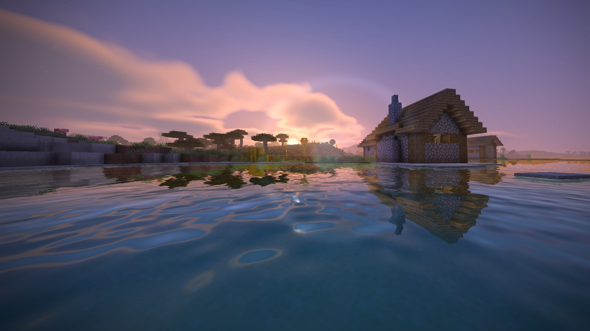
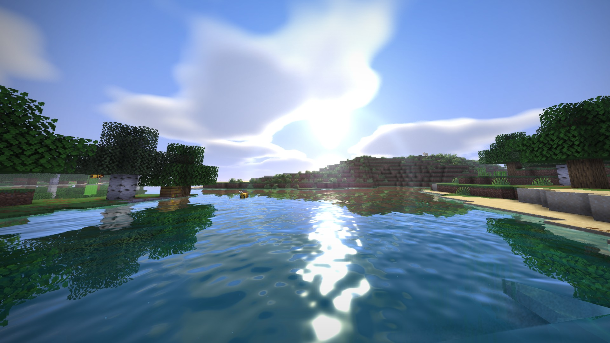
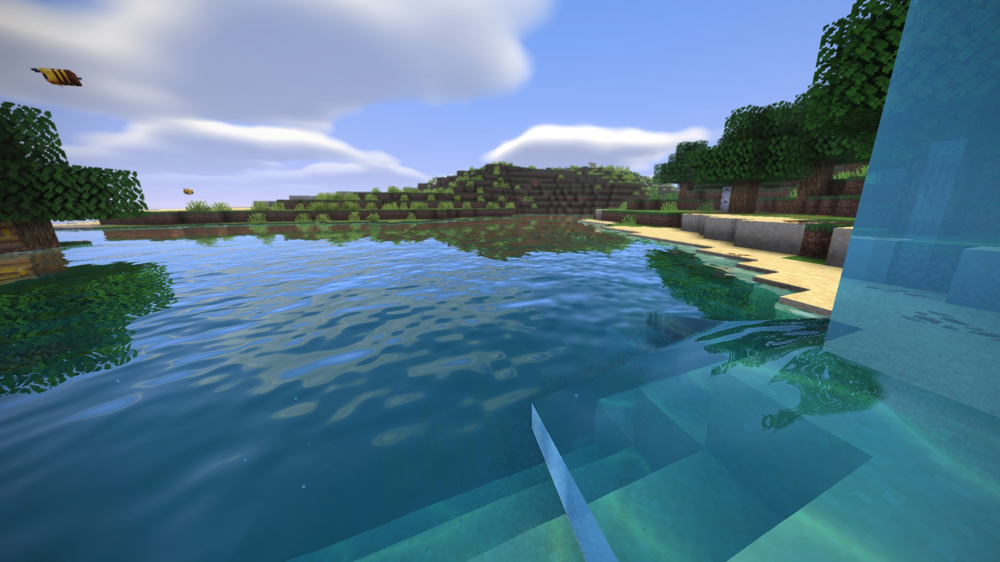
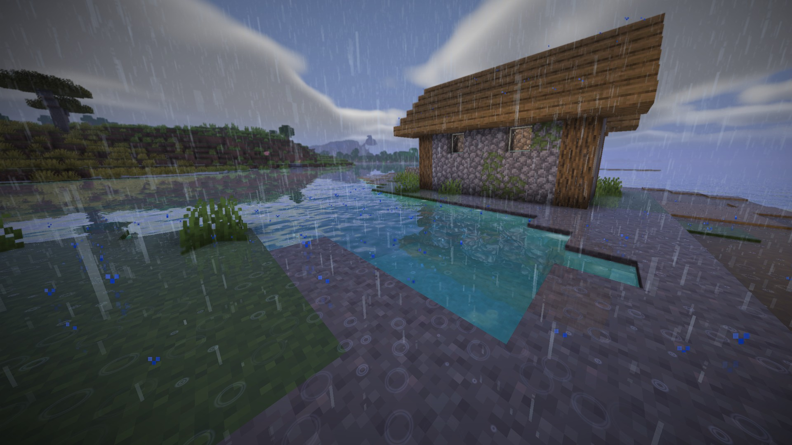
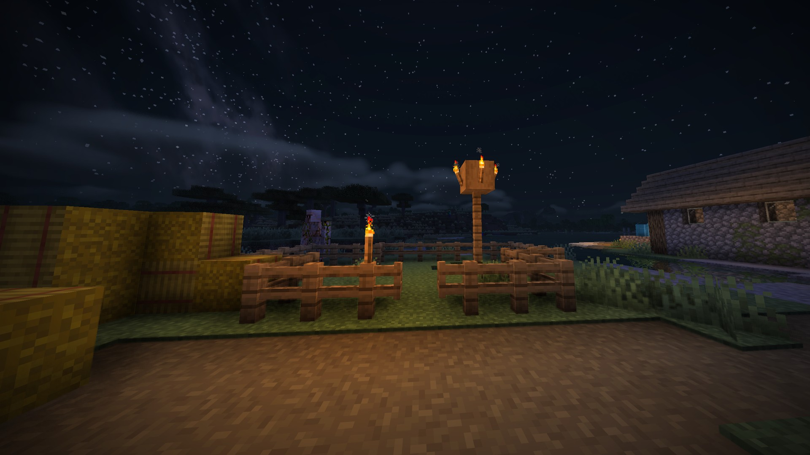
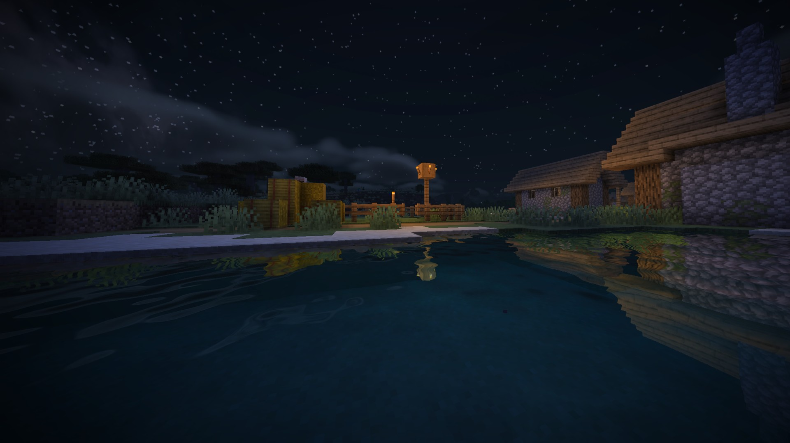

# Vivid Horizon

A shader pack for [Horizon](https://github.com/horizon-rust/horizon): vivid colours, a soft blue sky with
volumetric clouds, warm sunlight and cool blue shadows, mirror-like turquoise water, rain that soaks the
ground, and warm torch-lit nights under the Milky Way.



| | |
| --- | --- |
|  |  |
|  |  |



It aims for the look of the classic "vibrant" Minecraft shader packs, but every line is original, written
from public techniques. No code from any other shader pack was read, copied or adapted.

## Install

- **Launcher:** Mods > **Horizon** > search "Vivid Horizon".
- **By hand:** download `vivid_horizon-<version>.hshader` from
  [Releases](https://github.com/Evan-lhm/vivid-horizon/releases), put it in `shaderpacks/` beside
  `options.txt`, then pick **Vivid Horizon** in Options > Video Settings > Shaders > Shader Packs.

Shader Options... tunes every effect, on four pages: Colour, Light, Sky, Water and plants.

## What it does

**Sky.** Its own sky: soft blue by day, warm sunsets, deep blue-grey nights with the Milky Way, volumetric
clouds shaded by the sun, a sun disc and moon glow, and haze in the sky's colours.

**Light.** Shadows from the sun and moon (warm in the light, blue-violet in the shade), coloured shadows
under stained glass, ambient occlusion in corners and under leaves, volumetric god rays through leaves,
moonbeams. Block light in each source's colour: orange torches and fire, blue soul fire, red redstone, cool
white sea lanterns, yellow, green and pink froglights; held lights too.

**Water.** Clear turquoise water with refraction, depth colour, ripples, reflections of the world, a sun
glint, glowing shallows and soft shore foam by day, caustics on the bottom. Glassy waterfalls with sliding
streaks, clear even from inside. Underwater fog and light shafts.

**Rain.** Raindrop rings on water and on soaked ground, which darkens, takes a wet sheen and reflects
houses, trees and torches. Readable rainy nights.

**Camera.** Bloom, depth of field focused on what you look at, lens flare, exposure, contrast, saturation,
vibrance and vignette. Waving leaves, grass and crops, stronger in storms.

## Performance

About 4.5 ms of GPU per frame at 1440p on an RTX 5070 Ti. On a slower GPU, turn off (or lower) Shadows,
Volumetric clouds and Wet ground reflections first.

## Source

The pack is the [`vivid_horizon/`](vivid_horizon) folder (WGSL, Horizon shader API 0.1); its own
[README](vivid_horizon/README.md) lists what each file does. Check and build it with Horizon's tool:

```sh
horizon-shader check vivid_horizon
horizon-shader pack vivid_horizon
```

## License

MIT, see [LICENSE](LICENSE).
